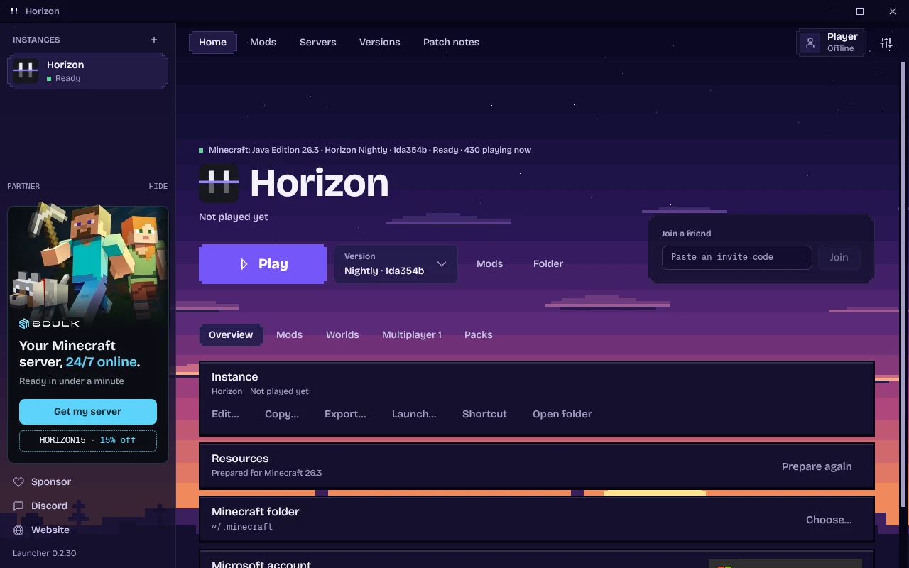
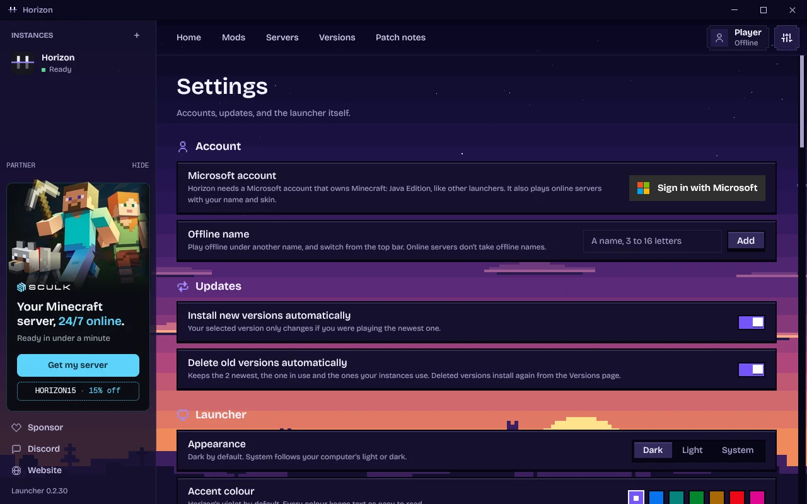

<h1 align="center">Horizon Java Bridge</h1>

<p align="center"><b>Real Fabric mods, running inside <a href="https://github.com/horizon-rust/horizon">Horizon</a>, the Rust rewrite of Minecraft: Java Edition 26.3.</b></p>

<p align="center">
  
  
  
  <a href="LICENSE"></a>
</p>

<p align="center">
  <a href="#get-it"><b>Get it</b></a> ·
  <a href="#what-works"><b>What works</b></a> ·
  <a href="#how-it-works"><b>How it works</b></a> ·
  <a href="docs/java-bridge-beta.md"><b>Testers' guide</b></a> ·
  <a href="https://trello.com/b/2uhi4jkj"><b>Mod tracker</b></a>
</p>

> **Unofficial, opt-in, beta.** Made by [iaxivers](https://github.com/iaxivers), with Windows support by [martipops](https://github.com/martipops). Built on [Horizon](https://github.com/horizon-rust/horizon) by Ludovic, who has agreed to take it into the main repository; that work is underway. Not an official Minecraft product, nor approved by or associated with Mojang or Microsoft. No Minecraft code, assets or data are included: you need your own copy of Java Edition 26.3.

Horizon plays Minecraft in Rust. The bridge lets it play the **mods people already use**: the same Fabric 26.3 jars you'd put in a normal mods folder, unchanged. Horizon keeps running the game (world, mobs, redstone, physics, saving, multiplayer, all rendering); a Java VM inside Horizon runs only the mods' own code, where a mod changes something. Turned off, it's plain Horizon with no Java at all.

## Get it

You need a Microsoft account that owns Minecraft: Java Edition, and Minecraft 26.3 played once in the official launcher. Playing with mods works only through the launcher, after sign-in: there's no offline way, and nothing for the mods is downloaded before you sign in.

1. **Download the launcher** from the [`java-mods` release](https://github.com/iaxivers/horizon-java-bridge/releases/tag/java-mods): `horizon-launcher-linux-x86_64.tar.gz` or `horizon-launcher-windows-x64.zip`. It never updates itself into the main Horizon launcher.
2. **Start it, sign in,** install a Horizon version and let it prepare from your Minecraft 26.3.
3. **Turn on "Fabric 26.3 mods (beta)"** under **Launch…** on Home. The launcher downloads the Fabric mods build of the game (signed, checked like the game itself) and Java 25 if you have none.
4. **Add Fabric 26.3 jars** in the **Java mods** tab and press **Play**. The first start with new mods takes a few minutes.

Found a bug? Post it with a screenshot or video, your mod list and `logs/latest.log` (in your game folder). The [testers' guide](docs/java-bridge-beta.md) has every step.

<details>
<summary>Build from source instead</summary>

```sh
git clone -b java-bridge https://github.com/iaxivers/horizon-java-bridge && cd horizon-java-bridge
cargo build --profile fast -p horizon-client --features horizon-client/java-mods
cd launcher && cargo build --release    # Fedora needs libxkbcommon-x11-devel
horizon-launcher java-mods use-build ../target/fast/horizon-client
```

Then steps 2–4 above. Start a self-built launcher with `HORIZON_LAUNCHER_NO_SELF_UPDATE=1`.
</details>

## What works

Of the 60 most-downloaded Fabric 26.3 mods, **39 work**, 4 renderer replacements are left out on purpose (Horizon has its own renderer), 16 play with one feature missing and 1 stops the game ([the survey](docs/java-bridge-survey.md)). An 81-jar pack (166 mods) plays on a real PC.

| Area | Status |
|---|---|
| Loading | ✅ 81- to 107-jar packs start (up to 265 mods, 20,000+ recipes); content made once per set of jars, Java's classes cached between runs |
| Blocks, items, recipes, creative tabs | ✅ placed mod blocks show at once; a modpack's bundled resource packs are picked up |
| Machines and their screens | ✅ Farmer's Delight (pot, stove, cutting board, meals), Tom's Storage, Energized Power, CC: Tweaked, XNet, BuildCraft; Horizon's hoppers and droppers fill and empty mod blocks |
| Create | 🚧 motors, shafts, presses, mixers, saws, burners and depots draw and work; value boxes, the toolbox, goggles' overlays, the mechanical arm's points, chain conveyors; items thrown into depots, millstones, crushers and fans; lava with Create's fluids. Not yet: train stations reliably, Ponder, contraptions' collisions |
| Mods' fluids | ✅ drawn with their own textures, flow by the mod's own code |
| JEI, REI, Jade, AppleSkin, tooltips | ✅ JEI's and REI's lists, search and recipes, per player |
| Maps | ✅ Xaero's Minimap and World Map, XaeroPlus, JourneyMap, VoxelMap, MiniHUD |
| Mod mobs | ✅ Naturalist, Friends & Foes, Mutant Monsters, GeckoLib mobs; they fight Horizon's mobs and players both ways |
| Mod worldgen | ✅ Biomes O' Plenty, Terralith, Towns and Towers, Dungeons and Taverns, mods' own structure types and template overrides (The Sift); Tectonic's far terrain; skyblock and one-block worlds; mods' own dimensions (The Sift, Every Mining Dimension) |
| Mods that change vanilla behaviour (mixins) | ✅ Veinminer, Right Click Harvest, Carry On, Serene Seasons, Clumps |
| Player look | ✅ 3D Skin Layers |
| Multiplayer with mods | ✅ LAN and dedicated servers: each player's own maps, recipe viewers and mod settings |
| The launcher | ✅ the only way to play: a **Fabric 26.3 mods (beta)** switch per instance and a **Java mods** tab (add, remove, which mods failed last game); fetches Java 25 after the Microsoft sign-in |
| Renderer replacements (Sodium, Iris) | ➖ not needed: Horizon has its own renderer, so they have nothing to replace |
| Known not working yet | 🐛 Flashback's recording, Chat Heads' heads, Litematica's overlay in the world; on LAN, the host's own REI list (each player running their mods' client, `HORIZON_JAVA_OWN_CLIENT=1`, is still opt-in). TACZ's guns fire and draw, still rough. Testers track mods on [their Trello](https://trello.com/b/2uhi4jkj) |
| Windows | ✅ builds and plays on Windows 11 (Windows support by [martipops](https://github.com/martipops)); macOS untested |


## How it works

- **Horizon owns the game.** Rust runs the world, ticks, mobs, physics, saving, networking and every frame.
- **Java runs only the mods.** A JVM in Horizon's process loads Fabric Loader, the mods and their mixins against the real 26.3 classes from your own install, and handles only what a mod changes; the result goes back into Horizon's world. Mods' screens and drawings are captured and drawn by Horizon's renderer.
- **Generic, no mod-specific code.** Nothing in the bridge targets one mod's internals; a test fails if a mod's package name appears in its code. Every bug fixed is fixed for every mod.
- **Off by default.** A cargo feature plus a per-instance launcher switch. Off means no Java, no downloads, no cost.

Details for developers: **[docs/java-bridge.md](docs/java-bridge.md)** (where everything is, the tick flow, 26.3 traps, the test tools). One-page overview: [docs/java-bridge-pitch.md](docs/java-bridge-pitch.md). Performance numbers: [docs/java-bridge-perf.md](docs/java-bridge-perf.md). Coming next: NeoForge 26.3 ([plan](docs/java-bridge-neoforge.md)) and Forge 1.12 / SkyFactory 4 on Cleanroom ([plan](docs/java-bridge-112.md)).

**Tests:** `python3 tools/java_bridge/regress.py --jars <jars>` plays every scene that once worked, headless, with screenshots.

---

# About Horizon (the game this builds on)

Everything below is [Horizon](https://github.com/horizon-rust/horizon)'s own README: Minecraft: Java Edition 26.3, rewritten in Rust, checked against the Java game by more than 300 differential harnesses. For plain Horizon without mods, use [its own launcher](https://playhorizon.dev).

## Download

Get **the Horizon launcher** from [playhorizon.dev](https://playhorizon.dev) or [the launcher releases](https://github.com/horizon-rust/horizon/releases?q=launcher&expanded=true) (Linux x86-64, macOS on Apple Silicon, macOS on Intel from the next Nightly, Windows x64). It installs and updates the game, prepares its files from your copy of Minecraft, and updates itself.

**You need** a Microsoft account that owns Java Edition ([why](docs/microsoft-account.md)) and a GPU with Vulkan or OpenGL 3.3 (Linux), Vulkan or DirectX 12 (Windows), or a Mac (Apple Silicon, or Intel from the next Nightly). An existing Minecraft install (official launcher, Prism, MultiMC...) is reused; without one, Play downloads 26.3 from Mojang for your account. Step by step: [Install and first launch](https://playhorizon.dev/docs/install).

<table>
  <tr>
    <td width="50%"></td>
    <td width="50%"></td>
  </tr>
</table>

## What works today

- **The game:** vanilla world generation, mobs, villagers, raids, redstone, every command, the HUD and the recipe book, on vanilla saves. Worlds from 1.8 to 26.2 are upgraded. [Status](#project-status).
- **Extras:** new menus, graphics presets, distant terrain up to 1024 chunks, controllers, zoom, minimap and more, off by default where they change the vanilla look. [Settings](https://playhorizon.dev/docs/settings).
- **Packs:** resource packs, and data packs with functions, predicates, item modifiers and world generation.
- **Multiplayer:** invite friends with a code, Open to LAN, join servers (online mode included). [Multiplayer](https://playhorizon.dev/docs/multiplayer).
- **Mods:** content mods (blocks, items, data) and native Rust mods, built by the launcher with nothing to install. Java mod jars do not run. [Mods](https://playhorizon.dev/docs/mods).

In the Rust client, with vanilla assets and no mods or shaders:

<table>
  <tr>
    <td colspan="2"></td>
  </tr>
  <tr>
    <td width="50%"></td>
    <td width="50%"></td>
  </tr>
  <tr>
    <td width="50%"></td>
    <td width="50%"></td>
  </tr>
</table>

## Host a server

The launcher's **Servers** page creates, starts, backs up and updates a server, and invites friends over Tailscale. On a VPS, `horizon-server` installs with one command and needs no Java. [Host a server](https://playhorizon.dev/docs/hosting) ([reference](docs/hosting.md)).

## Modpacks

The launcher imports Modrinth and CurseForge packs and plays the mods Horizon can carry over: today, content mods made of data and assets, not Java code. [Modpacks](https://playhorizon.dev/docs/modpacks).

## Agent control

AI agents and scripts can play Horizon. `horizon-ctl`, shipped with the game, reads its state as JSON and acts like a player; `horizon-ctl mcp` serves the same commands over MCP.

```sh
horizon-ctl launch --world Survival --seed 5 --wait   # finds the version the launcher installed
horizon-ctl state                                       # position, health, food, target, screen...
horizon-ctl find-block birch_log                        # the nearest logs
horizon-ctl goto -0.5 65 -2.5 --near 2.5                # walks there along a path
horizon-ctl break -1 65 -3                              # mines it; replies with the drops
horizon-ctl open-inventory && horizon-ctl click-slot 0  # menus: slots, buttons by label, text fields
```

Commands block until done and reply with the result; `horizon-ctl help` lists them all. [Agent control](docs/native-client.md#agent-control-horizon-ctl-and-mcp).

## Build from source

Needs Rust 1.90+, Python 3.10+, JDK 25, and on Linux `libasound2-dev libudev-dev`. `horizon-prepare` builds the game's resources from **your own copy** of Java Edition 26.3 (checked against `research-lock.json`) and never downloads it:

1. **Client:** play 26.3 once in the official launcher. Horizon reads `~/.minecraft` (or `--minecraft-dir` / `HORIZON_MINECRAFT_DIR`).
2. **Server jar:** the 26.3 server jar (`downloads.server.url` in `versions/26.3/26.3.json`), passed once with `--server-jar` or `HORIZON_SERVER_JAR`.

```sh
git clone https://github.com/horizon-rust/horizon.git
cd horizon
cargo run --release -p horizon-prepare -- --prepare --server-jar ~/Downloads/server.jar   # needs JDK 25
cargo run --release -p horizon-prepare -- sounds   # optional: sounds from your launcher install
cargo run --release -p horizon-client
```

Prepared files land in the gitignored `.local/`: never commit or share them. Options, controls and architecture: [the native client guide](docs/native-client.md); all developer docs: [docs/README.md](docs/README.md).

## Roadmap

What is in progress, what comes next and where to help: [ROADMAP.md](ROADMAP.md), or [playhorizon.dev/hub](https://playhorizon.dev/hub) with the work board and what shipped.

## Contributing

Issues and pull requests are welcome: read [CONTRIBUTING.md](CONTRIBUTING.md) (vanilla first, small pull requests). Questions: [Discord](https://discord.gg/playhorizon). Before a pull request, run the self-check and paste its output:

```sh
git config core.hooksPath .githooks
python3 tools/pr_ready.py
```

It runs rustfmt, clippy, the touched crates' tests, the Python tests, the public-tree check and the vanilla harnesses your change affects. Never commit game files, decompiled source or prepared resources.

## Project status

**Player-visible gaps: 0 open** of the 833 the [port ledger](tools/port_ledger.py) found, reading every vanilla 26.3 method against Horizon's code: vanilla behaviour a player would notice that Horizon doesn't have yet. By area: Animals [0](https://github.com/horizon-rust/horizon/issues/3512); Monsters and bosses [0](https://github.com/horizon-rust/horizon/issues/3513); Entities, projectiles, vehicles and decorations [0](https://github.com/horizon-rust/horizon/issues/3514); Items, enchantments and inventories [0](https://github.com/horizon-rust/horizon/issues/3515); Blocks, redstone and fluids [0](https://github.com/horizon-rust/horizon/issues/3516); World, world generation and saves [0](https://github.com/horizon-rust/horizon/issues/3517); Screens, HUD and client packets [0](https://github.com/horizon-rust/horizon/issues/3518); Entity and block rendering, models [0](https://github.com/horizon-rust/horizon/issues/3519); Server and players on the server [0](https://github.com/horizon-rust/horizon/issues/3520); Mob AI, villagers and raids [0](https://github.com/horizon-rust/horizon/issues/3521). This number goes down as gaps close (`tools/parity_gaps.py`); the harness results below say that what is tested matches.

The table is the project's own audit: every subsystem matches vanilla in every harness that compares it. 100% means 100% of what the harnesses compare, not that nothing else differs.

### Java parity: 100%

Scores: 0 (absent), 0.25 (started), 0.5 (playable, major features missing), 0.75 (mostly complete) or 1 (complete and verified by differential tests); the percentage is their average. Last audited 2026-10-13: the harnesses pass on Linux and macOS. The [port ledger](tools/port_ledger.py) adds a method-by-method view of what is ported.

| Subsystem | Score | Main gaps |
| --- | ---: | --- |
| Window, input and game loop | 1 | None: game loop, options, camera, auto-jump, toggle sprint/sneak and frame limiter match |
| Assets and resources | 1 | None: item models match over 196,290 stacks; the resource pack screen over 3,000 sessions |
| Network protocol and multiplayer | 1 | None: joins vanilla servers; the dedicated server matches vanilla's files, login, configuration, play and command tree; LAN discovery over 462 cases (offline mode only) |
| Chunk storage and palettes | 1 | None: client and saves share paletted containers, identical to vanilla over 266 scenarios |
| Section meshing | 1 | None: 112 scenes and over a million quads identical to vanilla |
| Rendering | 1 | None: entity models, block entity renderers (407 cases) and animations (296), HUD overlays (2,200 states), the recipe book (600), player list, subtitles and world border match |
| Lighting | 1 | None: saved and relit light matches vanilla, slabs and stairs included |
| World generation | 1 | None: 2,352 whole chunks over 225 structure sites, in all three dimensions, identical to vanilla |
| Region files and saves | 1 | None: saves round-trip with vanilla; worlds from 1.8 to 26.2 upgrade as vanilla's DataFixers do |
| Entities and physics | 1 | None: attributes, spawn rules, natural spawning (15,500 cases), raids and patrols (1,900), `finalizeSpawn` (24,000) and mob AI (92 scenarios) match |
| Interaction and inventory | 1 | None: menu clicks over 8,000 sequences; recipe book placement (6,000), buttons (1,200), saved book (1,500), loom and crafter screens (1,600) |
| Menus, HUD and chat | 1 | None: every command (758 over 39,685 inputs), scoreboards (81,000 operations), the player list (872,000 draw calls), chat and its suggestions (3,000 sessions) match |
| Audio | 1 | None: the sound engine, sound events, music, situational music, ambience and subtitles match vanilla |
| Block behaviours and ticking | 1 | None: block updates, random ticks, redstone, dispensers (6,000 cases), crafters (4,000), container spills (4,000), copper golems and the sculk family (435 scenarios) match |

### Known issues

Skins served over https show the default skin unless already cached; pack icons show the unknown-pack texture in game; item tooltips lack attribute lines.

## Licence

[MIT](LICENSE), for the project's original work; dependencies keep their own licences ([notices](THIRD_PARTY_NOTICES.md)). Minecraft is a trademark of Mojang Synergies AB; its code and assets belong to Mojang and Microsoft under the [Minecraft EULA](https://www.minecraft.net/en-us/eula).

## Author

Made by [Ludovic Marie](https://lu4ovic.com) ([@ludovic111](https://github.com/ludovic111)).
